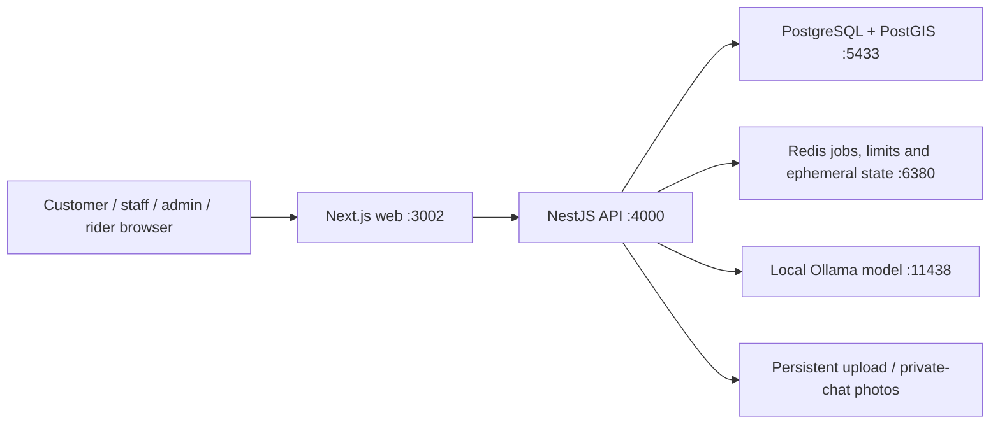

# Mimiz system and PC storage - 22 October 2026

Your database is already on this PC. It is PostgreSQL with PostGIS, stored in a persistent Docker volume. The main database measured 23 MB during this review. Installing a second database server would not address the large C: footprint.

## What runs where

| Part | Purpose | Storage location |
| --- | --- | --- |
| Main source | Application code and documentation | G:/CODE~BENNY/Projects/DEV/mimiz-fresh |
| Sandbox source | Separate review copy | G:/CODE~BENNY/Projects/DEV/mimiz-fresh-sandbox |
| PostgreSQL | Users, orders, menu, chat history and business records | Main Docker postgres_data volume |
| Redis | Background queues, rate limits and typing state | Main Docker redis volume |
| Uploaded photos | Dish photos and private chat attachments | Main Docker uploads_data volume |
| Ollama | Downloaded zero-spend local model | Main Docker ollama_data volume |
| Database/photo backups | Portable dumps, archives and checksums | Main project data/backups on G: |
| Build cache | Regenerable intermediate image layers | Docker-managed virtual disk on C: |
| Application images | Executable API/web releases and rollback versions | Docker-managed virtual disk on C: |

Compose project names keep main and sandbox volumes separate. Moving source code to G: did not move Docker's storage. The running configuration still uses simulated payments and messaging.

## Measured C: footprint

Measurements are a snapshot, not an overnight change log. GB/GiB units differ between Docker and Windows. Docker image/cache numbers share some layers and must not simply be added to one another.

| Item | Measured size |
| --- | --- |
| Docker virtual disk C:/Users/CODE~BENNY/AppData/Local/Docker/wsl/disk/docker_data.vhdx | 34.63 GiB |
| Docker images, including other local projects and rollback images | 14.71 GB reported by Docker |
| Docker build cache before this change | 18.92 GB, approximately 13.53 GB initially marked reclaimable |
| All Docker local volumes, including both environments | 1.536 GB reported by Docker |
| Main PostgreSQL database inside its volume | 23 MB |
| Windows pagefile.sys | 12 GiB |
| Windows hiberfil.sys | 9.52 GiB |
| Playwright browser installation | 0.54 GiB |
| npm download cache | 0.25 GiB |

These measurements explain substantial current usage, but do not prove the cause of the entire reported drop from 100+ GB. Windows, updates, other applications, and virtual-memory growth can also change free space. Paging and hibernation files were inspected, not modified.

## Opening the local database

A PostgreSQL client can connect with:

- Host: 127.0.0.1
- Port: 5433
- Database: mimiz_fresh
- User: mimiz
- Password: the existing POSTGRES_PASSWORD in the main project's ignored .env.

Do not paste the password into shared documentation or Git. The container's internal host is postgres, which is different from the Windows client host.

For restaurant use, keep one authoritative PostgreSQL database. The current local setup is suitable for development and owner review. A public service would need an always-on host, backups, monitoring and the go-live configuration already documented.

## Approved cleanup and longer-term options

The owner approved removing unused build cache after verification. The cleanup retains database/photo/model volumes and application images. Its measured result is recorded in improvements-2026-10-22.md.

Pruning cache frees Docker-managed storage, but the Windows VHDX file may not shrink immediately. No virtual-disk compaction, relocation, Windows pagefile change, hibernation change or volume removal is included in this cleanup.

For a lasting reduction of C: usage, Docker documents moving its WSL data location through Docker Desktop Settings > Resources > Advanced. Use a drive with enough free space and a verified backup; do not manually move or delete Docker's VHDX. H: and D: had substantially more free space than C: or G: at the initial inspection, but drive reliability and future capacity should be reviewed before choosing one.

Official references:
- [Docker Desktop WSL storage location](https://docs.docker.com/desktop/features/wsl/)
- [Docker build-cache garbage collection](https://docs.docker.com/build/cache/garbage-collection/)
- [Docker backup and restore](https://docs.docker.com/desktop/settings-and-maintenance/backup-and-restore/)
- [Microsoft WSL disk-space guidance](https://learn.microsoft.com/en-us/windows/wsl/disk-space)

## Cleanup result

After verification, the approved cache-only cleanup removed 19.6 GB as reported by Docker. Build cache is now zero. All named images and 11 data-volume names were retained. Immediate Windows C: readings were 21.43 GiB before and 21.34 GiB after, so the reclaimed Docker-internal space has not been returned to C: in that measurement. A supported VHDX compaction or Docker Desktop storage relocation would address the remaining host-space issue and has not been performed.
